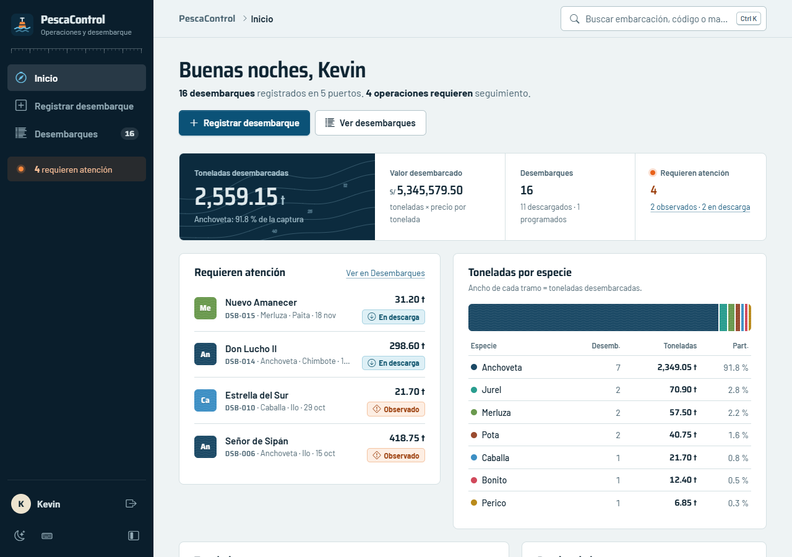

# PescaControl

**Sistema de Gestión de Operaciones Pesqueras y Desembarque**, desarrollado en **React** como práctica integradora (PC3) del curso en la Universidad Tecnológica del Perú (UTP).

Permite registrar cada desembarque en los puertos del litoral peruano (embarcación, matrícula, especie, arte de pesca, toneladas, precio, puerto, destino y estado de la descarga), consultarlos, editarlos y eliminarlos contra una API REST simulada con **json-server**, y seguir la operación desde un panel con indicadores.


## Stack

| Tecnología | Uso |
|---|---|
| React 19 + Vite | Interfaz y entorno de desarrollo |
| react-router-dom 7 | Rutas: Inicio, Registro, Lista |
| Bootstrap 5 + Bootstrap Icons | Estilos y componentes visuales |
| Axios | Cliente HTTP en `src/services/apiService.js` |
| json-server 0.17 | API REST falsa a partir de `db.json` |
| oxlint + Prettier | Calidad y formato de código |

> **¿Por qué Vite y no `create-react-app`?** La práctica menciona CRA, pero CRA está deprecado oficialmente por el equipo de React y falla con versiones actuales de Node. Vite cumple el mismo objetivo (crear y servir un proyecto React) y es la herramienta recomendada hoy. La estructura de `src/` sigue la propuesta de la práctica.

## Requisitos

- Node.js **20.19 o superior** (`node -v`)
- Git

## Instalación

```bash
git clone https://github.com/KevinDC65/PescaControl.git
cd PescaControl
npm install
```

## Ejecutar

```bash
npm run dev:all
```

Levanta a la vez:
- Frontend: http://localhost:5173
- API (json-server): http://localhost:3001/desembarques

| Script | Qué hace |
|---|---|
| `npm run dev` | Solo el frontend |
| `npm run server` | Solo la API (`db.json` en el puerto 3001) |
| `npm run dev:all` | Frontend + API |
| `npm run lint` | Revisa el código con oxlint |
| `npm run format` | Formatea `src/` con Prettier |
| `npm run build` | Compila para producción en `dist/` |

## Funcionalidades

- **Shell de aplicación:** barra lateral contraíble con contadores, barra inferior en móvil, paleta de comandos (`Ctrl+K`), atajos de teclado (`?` muestra la ayuda) y notificaciones tipo toast.
- **Inicio (panel de operaciones):** toneladas desembarcadas, valor desembarcado, desembarques y los que requieren atención; toneladas por especie y por puerto (carta del litoral de Paita a Ilo); listas de "Requieren atención" y "Últimos desembarques".
- **Registro:** formulario controlado en secciones (Embarcación, Captura, Operación) con validación en vivo, especie y estado como opciones visuales, valor estimado en vivo, sugerencia del prefijo de matrícula según el puerto, vista previa de la tarjeta, guardado con `Ctrl+S`, borrador en `localStorage` y aviso al salir con cambios sin guardar.
- **Edición:** `/registro/:id` carga el desembarque y guarda con `PUT`.
- **Desembarques:** vista tabla (orden por columna, selección y eliminación en lote) o tarjetas; búsqueda por embarcación, código o matrícula y filtros por especie, puerto, estado y rango de fechas guardados en la URL; detalle en panel lateral.
- **Sesión y tema:** inicio de sesión simulado y tema claro/oscuro compartidos con `useContext` y persistidos.
- **Estados:** indicador `Loading...`, esqueletos de carga, mensajes de éxito y error, página 404 y diseño adaptado a móvil.

| Atajo | Acción |
|---|---|
| `Ctrl+K` | Paleta de comandos y búsqueda de desembarques |
| `N` | Registrar desembarque |
| `/` | Buscar en la lista |
| `G` y luego `I` / `L` / `R` | Ir a Inicio / Lista / Registro |
| `Ctrl+S` | Guardar el formulario |
| `?` | Ayuda de atajos |



## Problemas comunes

| Síntoma | Solución |
|---|---|
| "No se pudo conectar con el servidor" | La API no está levantada: usa `npm run dev:all` o `npm run server` |
| `Port 3001 is already in use` | Cierra el otro json-server o cambia el puerto en `package.json` y en `.env` (`VITE_API_URL`) |
| Vite usa otro puerto (5174…) | El 5173 está ocupado; la app funciona igual en el puerto que indique la consola |
| Error de sintaxis al ejecutar Vite | Actualiza Node a 20.19 o superior |
| `db.json` aparece modificado tras probar | json-server reescribe el archivo; revisa con `git diff db.json` y restaura los 16 desembarques originales con `git checkout -- db.json` |

## Entrega

- Informe: [docs/PescaControl_PC3.pdf](docs/PescaControl_PC3.pdf) (fuente editable en [docs/informe/informe.html](docs/informe/informe.html)).
- Capturas: [docs/capturas/](docs/capturas/).
- Datos de prueba: [db.json](db.json).

## Documentación del proyecto

| Archivo | Para qué sirve |
|---|---|
| [PROYECTO.md](PROYECTO.md) | Objetivo, alcance, modelo de datos, endpoints y trazabilidad de requisitos |
| [PRODUCT.md](PRODUCT.md) | Usuarios y propósito del producto |
| [DESIGN.md](DESIGN.md) | Sistema visual: paleta, tipografía, componentes y movimiento |
| [ESTRUCTURA.md](ESTRUCTURA.md) | Carpetas, responsabilidades y flujo de datos |
| [CONTRIBUTING.md](CONTRIBUTING.md) | Reglas del equipo: ramas, commits, PR y estilo |
| [SPRINTS.md](SPRINTS.md) | Sprints, issues por desarrollador y seguimiento |
| [AGENTS.md](AGENTS.md) | Guía técnica rápida: todo el contexto del proyecto en un archivo |
| [docs/ENTREGA.md](docs/ENTREGA.md) | Guía para el PDF y las capturas de la entrega |

## Equipo

| Rol | Responsable | Área |
|---|---|---|
| Dev 1 | _por asignar_ | Shell, layout, calidad e integración |
| Dev 2 | _por asignar_ | Navegación, Inicio, paleta de comandos y capturas |
| Dev 3 | _por asignar_ | Formulario de desembarque, validaciones y edición |
| Dev 4 | _por asignar_ | Estado global, hooks, capas y documento PDF |
| Dev 5 | _por asignar_ | Datos, servicios REST y listado |
